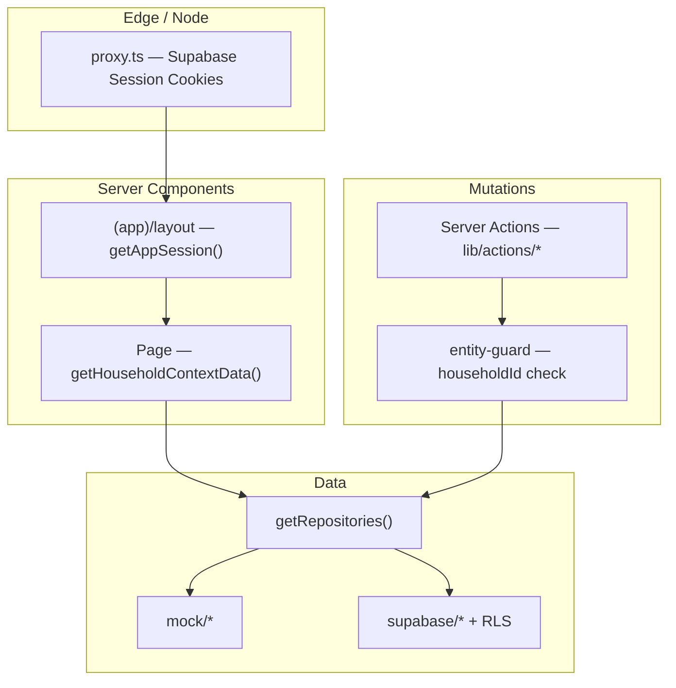
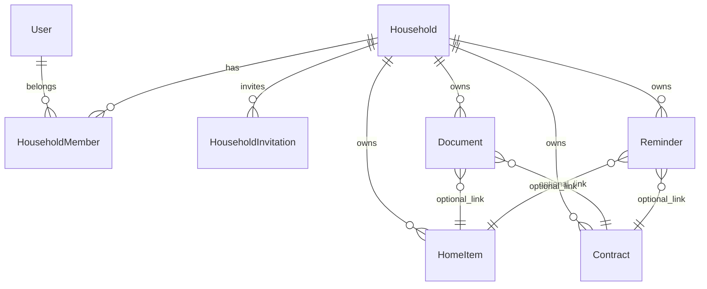

# Life Admin — Architektur

Canonical reference for the Life Admin codebase. Ursprünglich als **Step 1** im Architektur-Chat geplant (ohne Repo-Datei); dieser Stand beschreibt **V0.2** (Mock + Supabase, Auth, CRUD, Haushalt).

**Siehe auch:** [README](../README.md) · [Supabase](./SUPABASE.md) · [Deployment](./DEPLOYMENT.md) · [Linear-Projekt](https://linear.app/mnnsbstn/project/life-admin-f1ba6d229b25)

---

## 1. Produkt & Leitplanken

**Frage:** *Was muss ich in meinem privaten Leben gerade wissen, erledigen oder im Blick behalten?*

| Prinzip | Umsetzung |
|--------|-----------|
| **Domain-first, nicht Task-first** | CRUD und UI drehen sich um `HomeItem`, `Contract`, `Document`, `Reminder`. **Today** leitet Attention/Upcoming aus Domain-Daten ab — keine parallele „Task-Wahrheit“. |
| **Household als Mandant** | Alle fachlichen Entitäten haben `householdId`. Mehrbenutzer über `HouseholdMember`, RLS in Supabase. |
| **Modulare Erweiterbarkeit** | Feature-Ordner + `lib/modules/registry.ts` (später: Vehicles, Money, Family). |
| **Backend-ready** | Datenzugriff nur über **Repository-Interfaces**; Laufzeitwahl Mock vs. Supabase über Env. |
| **Server-first UI** | App Router, Server Components für Listen/Layouts; Client Islands für Forms, Dialoge, Quick Add. |

**Kernmodule ( aktiv ):** Today, Home, Contracts, Documents, Reminders  
**Registry ( deaktiviert ):** Vehicles, Money, Family — siehe `src/lib/modules/registry.ts`

---

## 2. Schichtenmodell

```
┌─────────────────────────────────────────────────────────────┐
│  Presentation — App Router, Layouts, Pages, UI              │
│    src/app/(app)/…  ·  components/ui|shell|domain           │
├─────────────────────────────────────────────────────────────┤
│  Features — modul-spezifische Views, Schemas, Mapper        │
│    src/features/{today,home,contracts,documents,reminders}  │
├─────────────────────────────────────────────────────────────┤
│  Application — Session, Household-Context, Server Actions   │
│    lib/auth/session.ts  ·  lib/actions/*  ·  lib/data/*    │
├─────────────────────────────────────────────────────────────┤
│  Domain Services — pure Logik (Dashboard, Status, Meta)     │
│    lib/services/dashboard.service.ts  ·  lib/domain/*         │
├─────────────────────────────────────────────────────────────┤
│  Data Access — Repository interfaces + Mock / Supabase      │
│    lib/repositories/*                                       │
└─────────────────────────────────────────────────────────────┘
```

**Abhängigkeitsregel:** UI → Features → Actions/Services → Repositories → Domain. Domain importiert weder React noch Next.js.

---

## 3. Laufzeit: Request-Flow



| Einstieg | Rolle |
|---------|--------|
| `src/proxy.ts` | Bei `NEXT_PUBLIC_DATA_SOURCE=supabase`: Session-Cookies, Redirect unauthenticated → `/login` |
| `getAppSession()` | User + aktiver Haushalt; Supabase: `ensure_my_household` RPC falls nötig |
| `getHouseholdContextData()` | Parallel-Load aller Module-Listen für den Haushalt |
| `lib/actions/*` | Create/Update/Delete; immer `householdId` aus Session + `assertEntityInHousehold` |

---

## 4. Routing

| Route | Zweck |
|-------|--------|
| `/` | Redirect → `/today` |
| `/today` | Dashboard (Attention + Upcoming) |
| `/home`, `/home/new`, `/home/[id]`, `/home/[id]/edit` | Home Items |
| `/contracts`, … | Verträge (gleiches Muster) |
| `/documents`, … | Dokumente; `/documents/[id]/download` für Storage |
| `/reminders`, … | Erinnerungen |
| `/settings` | Haushalt, Einladungen, Datenquelle |
| `/profile` | Profil, Abmelden |
| `/login`, `/auth/callback` | Supabase Auth |
| `/invite/[token]` | Einladung annehmen |

Navigation: `src/config/navigation.ts` (Sidebar + Mobile).

---

## 5. Domain-Modell

**Source of truth (TypeScript):** `src/lib/domain/types.ts`  
**Postgres / RLS:** `supabase/migrations/*.sql`



**Verknüpfungen:** Documents und Reminders nutzen discriminated unions (`link.type` + `id`), in Supabase als `linked_entity_type` / `linked_entity_id`.

**Reminder-Status:** Gespeichert + abgeleitet — `lib/domain/reminder-status.ts` (`withDerivedReminderStatus`).

---

## 6. Dashboard-Engine

**Datei:** `src/lib/services/dashboard.service.ts` (pure functions, Unit-Tests unter `tests/`).

| Quelle | Regel (Kurz) | Attention-Kind |
|--------|----------------|----------------|
| `HomeItem.warrantyEndsAt` | Fenster ~30 Tage / leicht überfällig | `warranty` |
| `HomeItem.nextMaintenanceAt` | wie oben | `maintenance` |
| `Contract.nextCancellationDate` | Kündigungsfenster | `cancellation` |
| `Contract.contractEndDate` | Vertragsende | `contract_end` |
| `Reminder` | fällig / überfällig, nicht completed | `reminder` |

Konstanten: `lib/constants.ts` (`ATTENTION_WINDOW_DAYS`, `UPCOMING_WINDOW_DAYS`, …).

**Output:** `AttentionItem` / `UpcomingItem` in `types.ts` — **nicht persistiert**, nur für Today.

---

## 7. Datenzugriff (Repositories)

**Factory:** `getRepositories()` in `src/lib/repositories/index.ts`

| Env | Verhalten |
|-----|-----------|
| `NEXT_PUBLIC_DATA_SOURCE=mock` (Default) | In-Memory Mock + Seed (`lib/repositories/mock/`) |
| `supabase` + URL + Anon Key | `createSupabaseRepositories()` — Postgres + RLS |
| `supabase` ohne Keys | Warnung, Fallback Mock |

**Interfaces:** `src/lib/repositories/types.ts` — `UserRepository`, `HouseholdRepository`, `HomeItemRepository`, …

**Supabase-Details:** Mapper unter `lib/repositories/supabase/mappers/`, Dokument-Upload: Bucket `life-admin-documents` — siehe [SUPABASE.md](./SUPABASE.md).

**Diagnose (Settings-UI):** `getRepositoryDiagnostics()`.

---

## 8. Auth & Haushalt

| Modus | Session |
|-------|---------|
| Mock | Demo-User / Demo-Household über Repositories |
| Supabase | `auth.users` + `profiles`; Mitgliedschaft in `household_members` |

- **Einladungen:** `HouseholdRepository.createInvitation`, Route `/invite/[token]`
- **Rollen:** `owner` \| `member` \| `viewer` (Owner: Name, Einladungen)
- **Neue User:** Trigger/Seed-Migrationen legen Haushalt + Demo-Daten an (siehe Supabase-Doku)

---

## 9. UI & State

| Bereich | Umsetzung |
|---------|-----------|
| Design System | shadcn/ui + Tailwind 4, Domain-Komponenten unter `components/domain/` |
| Shell | `AppShell`, Sidebar, Mobile Nav, Quick Add (⌘/Ctrl+K) |
| Forms | react-hook-form + Zod (`features/*/schemas`) |
| Client State | Dialoge, Sheets; React Query Provider vorhanden, **Hauptpfad** ist RSC + Server Actions + `revalidatePath` |
| i18n | UI überwiegend Deutsch; Code/Types Englisch |

---

## 10. Deployment-Modi

| Ziel | Fähigkeiten |
|------|-------------|
| **Lokal / Vercel** | Volle App: Auth, Server Actions, Supabase, Document Download |
| **GitHub Pages** | Statischer Export (`npm run build:gh-pages`), read-only Mock, Banner — siehe [DEPLOYMENT.md](./DEPLOYMENT.md) |

Erkennung: `lib/deployment-mode.ts` (`NEXT_PUBLIC_GITHUB_PAGES`).

---

## 11. Roadmap (10 Steps) — Stand

| Step | Inhalt | Status |
|------|--------|--------|
| 1 | Architektur (dieses Dokument) | ✅ |
| 2 | Project Setup | ✅ |
| 3 | Design System | ✅ |
| 4 | Application Shell | ✅ |
| 5 | Today Dashboard | ✅ |
| 6 | Core Modules (Listen) | ✅ |
| 7 | Detail Views | ✅ |
| 8 | Forms (Create/Edit) | ✅ |
| 9 | Responsive | ✅ (laufend polieren) |
| 10 | Review (A11y, Tests, Tech Debt) | 🔄 fortlaufend |

**Architektur-Nacharbeiten (Backlog):**

- ~~Vertrags-Kündigungstermine~~ → `lib/domain/contract-dates.ts`
- ~~Einheitlich `getAppSession`~~ (`demo-session.ts` entfernt)
- Optional: Realtime / React Query für optimistic UI
- Neue Module: Vehicles, Money, Family — Registry + Repositories + Routes

---

## 12. Bewusst nicht im Scope (V1)

KI-Eingabe, Banking/Kalender/E-Mail, OCR, Push-Notifications, E-Mail-Versand für Einladungen (Link kopieren), vollständiges Finance-Tracking.

---

## 13. Verzeichnis (Ist-Struktur, gekürzt)

```
src/
├── app/(app)/          # Routen + layout (Shell)
├── app/login/          # Auth UI
├── components/ui|shell|domain|forms/
├── features/           # pro Modul: components, schemas, lib/map-form
├── lib/
│   ├── domain/         # types, reminder-status, *-meta
│   ├── services/       # dashboard.service
│   ├── repositories/   # mock + supabase
│   ├── actions/        # Server Actions
│   ├── auth/           # session
│   ├── data/           # household context loader
│   └── supabase/       # client, server, env, storage
├── config/             # navigation, categories, …
└── providers/          # QueryClient, HouseholdContext
supabase/migrations/    # Schema, RLS, Storage, Seed
tests/                  # dashboard + mapper tests
```

---

## 14. Änderungen an dieser Doku

Bei strukturellen Änderungen (neues Modul, neuer Datenzugriff, Auth-Flow): **README**-Abschnitt „Architektur“ kurz halten, Details hier pflegen; Linear-Issue unter Projekt **Life Admin** verknüpfen.
